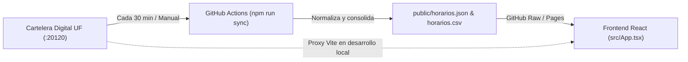

# 🎓 Horarios Universidad Favaloro (no oficial)

Aplicación web interactiva para consultar, filtrar y buscar de forma rápida los horarios de cursada, aulas, comisiones y docentes de la **Universidad Favaloro**.

🌐 **Demo en vivo:** **[https://franco4447.github.io/horarios_favaloro/](https://franco4447.github.io/horarios_favaloro/)**

---

## ✨ Características principales

- **Filtros combinables en tiempo real:**
  - 📅 **Fecha:** Inicia automáticamente posicionado en el día de **hoy** (huso horario `America/Argentina/Buenos_Aires`) y permite explorar toda la semana.
  - 🎓 **Carrera y Año:** Normaliza automáticamente las nomenclaturas de año (`1º año`, `2º año`, etc.) entre los distintos sistemas de la facultad.
  - 🕒 **Turno:** Clasificación automática en *Turno Mañana* (`< 15:00`) y *Turno Vespertino* (`>= 15:00`).
  - 💻 **Modalidad:** Filtrado entre clases **Presenciales** y **Virtuales** (detectando automáticamente aulas virtuales `z_*` y banderas de virtualidad).
  - #️⃣ **Comisión:** Búsqueda rápida por número o código de comisión (ej. `1`, `FYB`, `C2`).
  - 🔍 **Búsqueda libre:** Filtra al instante por nombre de materia/actividad, docente, sede, aula u observaciones.
  - 🗄️ **Origen de datos:** Permite alternar entre **Todos**, **SIU Guaraní** (`postgresql`) e **Interno** (`sql_server`).
- **Memoria de filtros por usuario (`localStorage`):**
  - La página recuerda automáticamente en el navegador de cada dispositivo la combinación de filtros elegida (**Carrera**, **Año**, **Turno**, **Modalidad**, **Comisión**, **Búsqueda** y **Origen**) para que no sea necesario volver a configurarlos al entrar nuevamente.
- **Actualización automática cada 30 minutos:**
  - Un workflow de **GitHub Actions** consulta periódicamente la Cartelera Digital de la universidad y actualiza los archivos públicos de datos en el repositorio.

---

## 🏗️ Arquitectura y flujo de datos

La Cartelera Digital oficial de la universidad (`multi_db`) combina registros provenientes de dos motores:
1. **SIU Guaraní (`postgresql`):** Comisiones, materias y asignaciones áulicas de toda la semana.
2. **Sistema Interno (`sql_server` - `SP_REPORTE_CARTELERA_DIGITAL_V2`):** Programación diaria de cursos, ateneos, posgrados y eventos especiales.



### Cascada de lectura en el Frontend (`lib/cartelera.ts`)
1. **Entorno local (`npm run dev`):** Consulta en vivo la API de la Cartelera a través del proxy configurado en `vite.config.ts`.
2. **Producción (`GitHub Pages`):** Consume el JSON consolidado desde `raw.githubusercontent.com` (reflejando el último commit generado por GitHub Actions sin problemas de CORS).
3. **Respaldo local:** Si no hay conexión externa, utiliza el snapshot `horarios.json` empaquetado en el build.

---

## 📦 Fuentes de datos públicas

El repositorio expone los horarios ya normalizados con CORS habilitado (`Access-Control-Allow-Origin: *`):

- **JSON:** [`https://raw.githubusercontent.com/Franco4447/horarios_favaloro/main/public/horarios.json`](https://raw.githubusercontent.com/Franco4447/horarios_favaloro/main/public/horarios.json)
- **CSV:** [`https://raw.githubusercontent.com/Franco4447/horarios_favaloro/main/public/horarios.csv`](https://raw.githubusercontent.com/Franco4447/horarios_favaloro/main/public/horarios.csv)

---

## 🚀 Desarrollo local

### Requisitos previos
- **Node.js** 20 o superior
- **npm**

### Instalación y uso

1. **Clonar el repositorio:**
   ```bash
   git clone https://github.com/Franco4447/horarios_favaloro.git
   cd horarios_favaloro
   ```

2. **Instalar dependencias:**
   ```bash
   npm install
   ```

3. **Sincronizar manualmente los datos desde la Cartelera oficial (opcional):**
   ```bash
   npm run sync
   ```
   *(Genera y actualiza `public/horarios.json` y `public/horarios.csv`).*

4. **Iniciar el servidor de desarrollo:**
   ```bash
   npm run dev
   ```
   La aplicación estará disponible en `http://localhost:3000`.

5. **Compilar para producción:**
   ```bash
   npm run build
   ```

---

## 📁 Estructura del proyecto

```text
├── .github/workflows/
│   ├── deploy-pages.yml    # Compila y despliega automáticamente la web en GitHub Pages
│   └── sync-horarios.yml   # Sincroniza los horarios cada 30 min desde la Cartelera UF
├── components/ui/          # Componentes visuales reutilizables (shadcn/ui)
├── lib/
│   ├── cartelera.ts        # Cliente HTTP, normalizador multi_db y cascada de datos
│   └── utils.ts            # Utilidades de clases CSS (clsx + tailwind-merge)
├── public/
│   ├── horarios.json       # Dataset consolidado en formato JSON
│   └── horarios.csv        # Dataset consolidado en formato CSV
├── src/
│   ├── App.tsx             # Interfaz principal, filtros persistentes y tabla de horarios
│   ├── index.css           # Configuración de estilos y tema (Tailwind CSS v4)
│   └── main.tsx            # Punto de entrada de React
├── fetch.ts                # Script CLI de ingesta y actualización de JSON/CSV
└── vite.config.ts          # Configuración de Vite y proxy hacia la Cartelera UF
```

---

## 🛠️ Tecnologías utilizadas

- **Frontend:** React 19 + TypeScript
- **Build Tool:** Vite 6
- **Estilos y UI:** Tailwind CSS v4, shadcn/ui, Lucide Icons
- **Automatización y Hosting:** GitHub Actions + GitHub Pages

---

> **Nota:** Este proyecto es una herramienta estudiantil **no oficial** creada para facilitar la consulta de horarios y aulas de la Universidad Favaloro.
